  

    

  
  
  
  

 

<h3 align="center">✨ Things I've built</h3>

<table align="center">
  <tr>
    <td width="50%" valign="top">
      <h4>⚡ PowerGrid</h4>
      
Power forecasting and anomaly detection dashboard. I built the frontend.

      
<code>Frontend</code> <code>ML dashboard</code>

    </td>
    <td width="50%" valign="top">
      <h4>🤖 <a href="https://github.com/ArchieTyagi/shopbot-qa">ShopBot QA</a></h4>
      
Test automation project with full CI, deployed on Vercel.

      
<code>Python</code> <code>pytest</code> <code>Selenium</code> <code>Postman</code> <code>GitHub Actions</code>

    </td>
  </tr>
  <tr>
    <td width="50%" valign="top">
      <h4>🎤 AI Interview Studio</h4>
      
Mock interview platform, my CSUF college project.

      
<code>AI</code> <code>Web app</code>

    </td>
    <td width="50%" valign="top">
      <h4>🏫 Nexus Campus</h4>
      
One of my featured campus projects.

      
<code>Web app</code>

    </td>
  </tr>
  <tr>
    <td width="50%" valign="top">
      <h4>💳 Mifos Customer Portal</h4>
      
Customer portal built for my Semester 1 OJT.

      
<code>Web app</code> <code>Team project</code>

    </td>
    <td width="50%" valign="top">
      <h4>🌐 <a href="https://my-portfolio-lake-sigma-99.vercel.app/">My Portfolio</a></h4>
      
Everything about me and my work in one place.

      
<code>Vercel</code>

    </td>
  </tr>
</table>

 

  💌 Always happy to talk about ML, open source or internships. 
  Say hi on <a href="https://www.linkedin.com/in/archie-tyagi-873364343/">LinkedIn</a> 🌸

